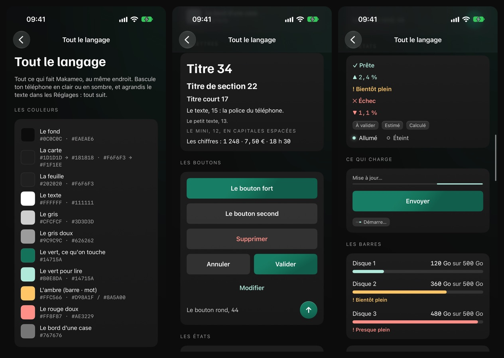
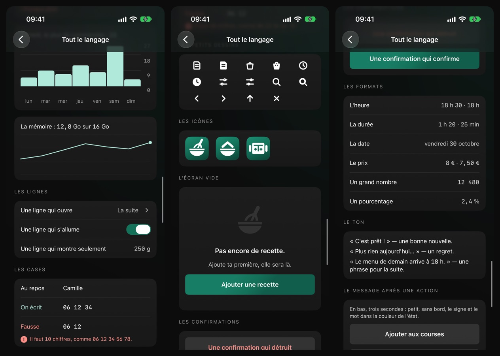
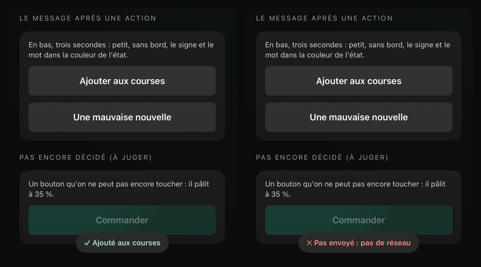
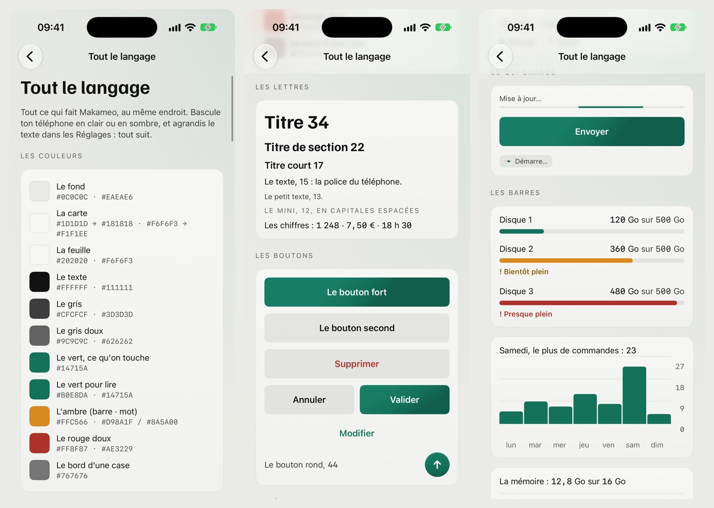
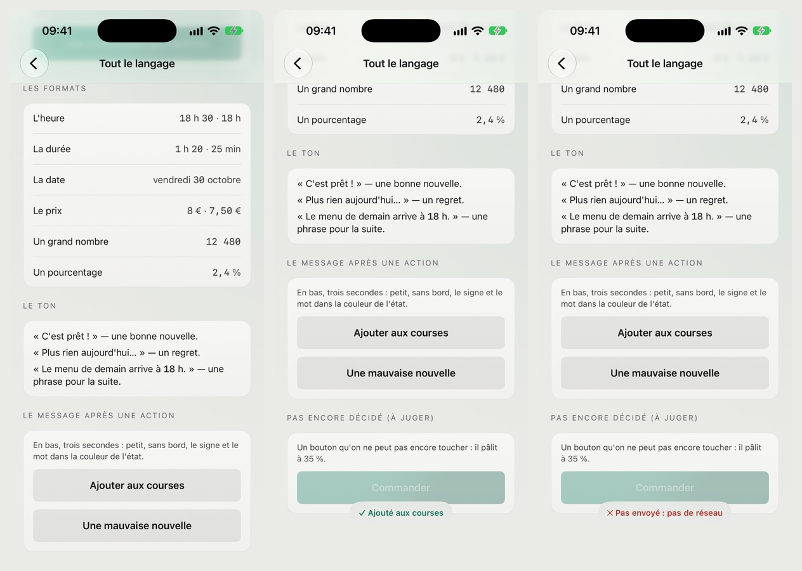
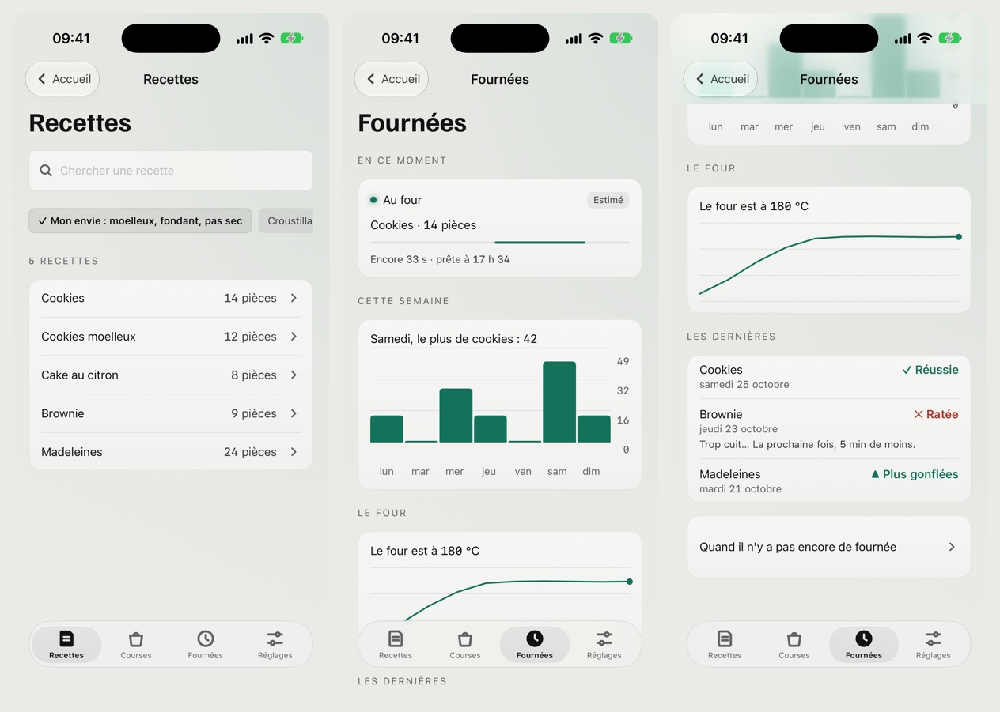
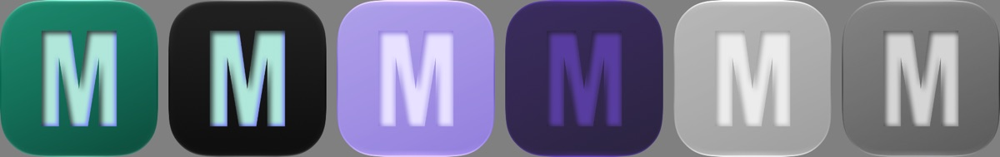
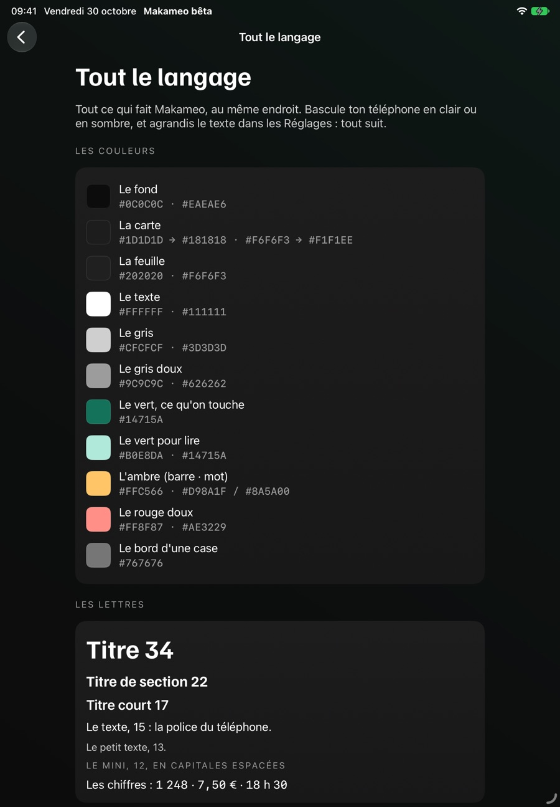
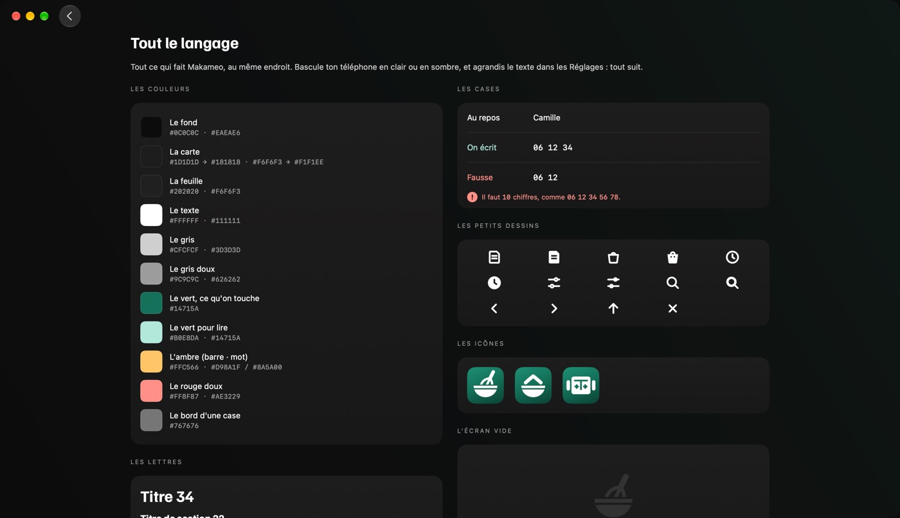
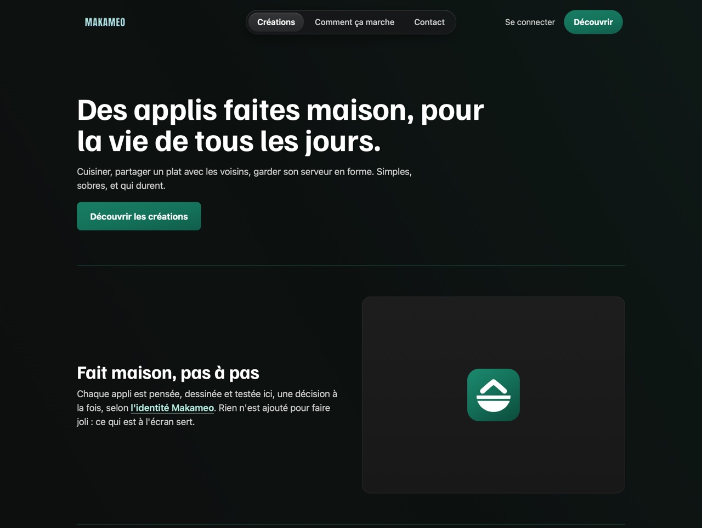

# Makameo — l'identité visuelle, version 1.1.0

Makameo, c'est le nom qui rassemble les applis que je crée moi-même : **MakaCook** (des recettes sûres, que tu ajustes à toi), **MakaEats** (la cuisine maison, à récupérer près de chez toi), **Tayko** (un assistant pour apprendre à discuter avec une intelligence artificielle), et les suivantes.

Ce dépôt montre leur identité visuelle commune : ce que j'ai décidé, et pourquoi.

**Version 1.1.0, du 30/10/2026.** La même identité, maintenant sur le téléphone, la tablette, le Mac et le web. La première version, la 1.0.0, date du 27/10/2026. L'identité peut encore changer, mais un seul point à la fois, jamais tout d'un coup.

---

## Tout le langage, sur une page

Toutes les pièces de l'identité sont réunies sur une seule page de la bêta, une petite appli d'essai : les couleurs, les lettres, les boutons, les états, ce qui charge, les barres, les cases, les petits dessins, les icônes, l'écran vide, les formats, le ton et le message qui suit une action.

| | Ce que j'ai décidé | Pourquoi |
|---|---|---|
| **La couleur** | Un seul vert : foncé (#14715A) pour ce qu'on touche, clair (#B0E8DA) pour ce qu'on lit. Jamais en grande surface. | Une couleur rare guide l'œil. |
| **Le fond** | Très sombre (#0c0c0c), des cartes un cran au-dessus, un voile vert très léger en haut. | Sobre, sans être triste. |
| **Les lettres** | Familjen Grotesk pour les titres, la police de l'appareil pour le texte. | Des titres qui ont du caractère, un texte qui se lit sans effort. |
| **Les chiffres** | Toujours dans une police aux chiffres alignés, même au milieu d'une phrase. | Un chiffre se repère et se compare d'un coup d'œil. |
| **Les formats** | « 18 h 30 », « vendredi 30 octobre », « 7,50 € », « 12 480 ». | Écrits comme en France, pas comme une machine. |
| **Les tailles** | Sur le téléphone : titre 34, texte 15, petit texte 13, mini 12. Un cran plus grand sur une tablette, une échelle propre sur le Mac. | Une hiérarchie nette, adaptée à chaque écran. |
| **L'espace et les coins** | Marges de 20, cartes de 16. Coins de 16 pour les cartes, 8 pour ce qu'on presse, 24 pour les grandes surfaces. | Ce qui se touche se voit tout de suite. |
| **Les états** | Un signe et un mot : vert clair pour une bonne nouvelle, rouge doux pour une mauvaise. Jamais la couleur seule. | Lisible même sans voir les couleurs. |
| **Les barres** | Trois couleurs : vert clair (ça va), ambre (attention), rouge doux (alerte). Le chiffre et le mot sont toujours écrits à côté. | La couleur prévient, le mot explique. |
| **Le point d'état** | « Allumé » : un point vert clair qui grésille doucement. « Éteint » : un anneau vide, au trait plein. | Un rond en pointillés ferait croire que ça charge. |
| **Ce qui charge** | Une fine ligne qui glisse, la même que sous le logo. Jamais une roue. | La même ligne partout, du lancement au moindre envoi. |
| **Le ton** | « L'appli te parle, mais n'est pas un robot. » | Clair d'abord, chaleureux sans être mignon. |
| **Ce qu'il n'y a pas** | Pas de décor, pas de bulles de dialogue, pas de personnages (sauf l'icône de Tayko). | Le contenu d'abord. |

---

## Le clair et le sombre

**L'appli suit le réglage de l'appareil.** Si le téléphone, la tablette ou le Mac est en sombre, l'appli est en sombre ; s'il est en clair, elle est en clair. Il n'y a pas de bouton dans l'appli pour choisir. C'est ce que recommande Apple : les gens s'attendent à ce que chaque appli « respect their preference » (Apple, Human Interface Guidelines, « Dark Mode »).

Le sombre est dessiné d'abord. Le clair en découle, adouci, sans blanc pur, pour ne pas éblouir.

**Dans une appli.** Les mêmes pièces, posées dans MakaCook : la liste des recettes, la fournée en cours, la semaine en barres, la courbe du four.

---

## La marque

**Le logo.** « MAKAMEO » en majuscules, police Anton. Les lettres sont vert clair et creusées, avec une ombre intérieure noire et un reflet néon bleu-violet. Au lancement d'une appli, il s'allume comme une lumière qui grésille.
*Pourquoi :* j'aime le futur glissé dans une époque passée, sans que ça sonne faux. Ici, une police d'affiche classique, et un seul détail du futur : le néon qui bugue. Le bleu-violet appartient à la marque, jamais aux écrans des applis.

**Le M seul.** Quand la place manque (l'icône de Makameo, une étiquette), c'est le M, dans le même style.

**Les icônes des applis.** Un fond vert en léger dégradé, et un symbole blanc dessiné pour chaque appli : un objet de la vie, jamais un symbole tout fait. Une forme pleine, les détails creusés dedans, des traits aux bouts arrondis, le même poids pour toutes. Une icône nouvelle part d'un gabarit et se juge à côté des autres avant d'entrer dans la famille.

**En sombre aussi.** Une icône est faite de deux calques : le fond et le symbole. En sombre, le fond devient noir et le symbole vert clair, comme les écrans. Les versions teintée et transparente, l'appareil les fabrique lui-même à partir de ces deux calques.

---

## Sur chaque écran

Le téléphone reste la référence. La tablette, le Mac et le web reprennent tout, et ne changent que ce que l'appareil demande.

- **La tablette :** c'est la largeur de la fenêtre qui décide. En fenêtre large, le texte prend un cran de plus et une liste s'ouvre en deux panneaux.
- **Le Mac :** une barre sur le côté, des cartes en grille, des boutons faits pour le pointeur, les menus et les raccourcis du Mac. Le texte s'agrandit jusqu'à 200 % avec ⌘ +.
- **Le web :** la page s'ouvre d'un lien ou d'un QR code, sans rien à installer. Elle montre son contenu tout de suite et n'appelle aucun service extérieur.

**Pour tout le monde.** Le texte a un contraste d'au moins 4,5 contre 1. Ce qu'on touche fait au moins 44 × 44 points au doigt, et 32 au pointeur sur le Mac. Le texte suit la taille choisie dans l'appareil, jusqu'à au moins 200 %, sans être coupé. C'est ce que recommande Apple.

---

## Ma méthode

- **Une page blanche.** Je ne suis parti d'aucune appli existante : j'ai d'abord dessiné un écran qui réunit tout, puis j'ai décidé chaque point.
- **Une décision à la fois**, toujours avec un avant / après sous les yeux, et deux ou trois façons de faire quand il y avait un vrai choix.
- **Tout se juge sur une image d'ensemble**, jamais sur un détail seul.
- **Chaque décision vaut pour les quatre écrans** : le téléphone, la tablette, le Mac et le web.
- **Essayé en vrai** : la bêta tourne sur iPhone, sur iPad et sur Mac, en sombre et en clair, avec le texte agrandi.
- **Les envies nouvelles attendent** : elles sont notées pour la version suivante, au lieu de tout faire bouger.

---

## Ce qui viendra plus tard

Un vrai symbole de la marque, un son pour l'écran de chargement, une palette d'éléments pour les affiches, Android… Tout ça est noté pour les prochaines versions.

---

## Les versions

- **1.1.0** (30/10/2026), mise à jour : la tablette, le Mac et le web ; l'icône en sombre ; les chiffres toujours alignés ; les formats ; les barres en trois couleurs ; le message après une action. Rien à réapprendre.
- **1.0.1** (27/10/2026), correctif : le texte agrandi, jusqu'à 200 %.
- **1.0.0** (27/10/2026) : la première, validée point par point.

---

## Droits

© 2026 Makameo. Tous droits réservés. Ce dépôt n'a pas de licence : on peut le regarder et s'en inspirer, mais pas copier ni réutiliser ce qu'il contient.

Les polices Anton et Familjen Grotesk sont libres (SIL Open Font License) et appartiennent à leurs auteurs.

Les textes des maquettes sont inventés. Pour ce travail, j'ai utilisé Claude Code, une IA d'Anthropic, comme outil : elle propose, dessine et construit la bêta ; je décide de chaque point.
