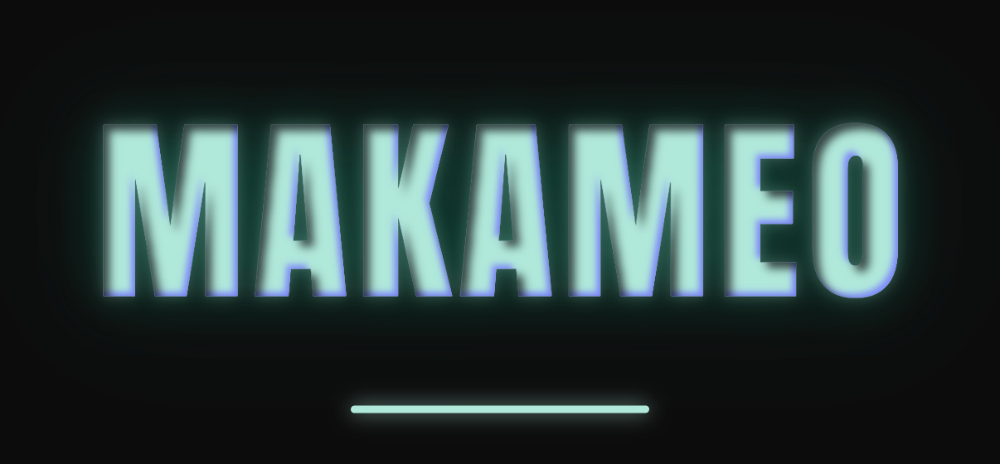
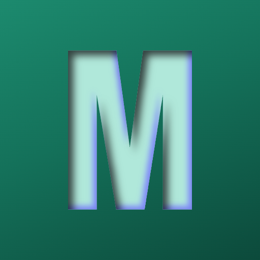
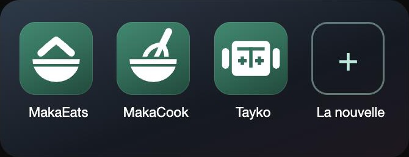
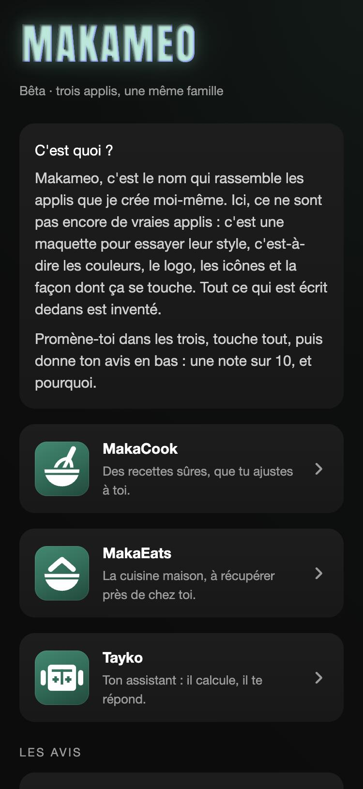
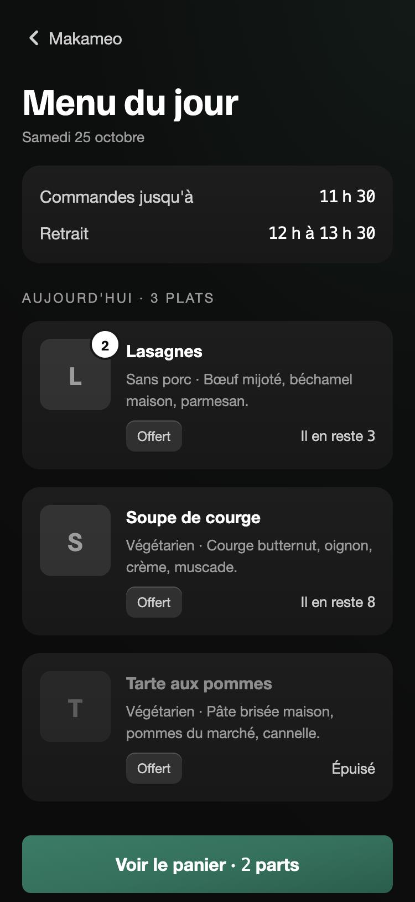
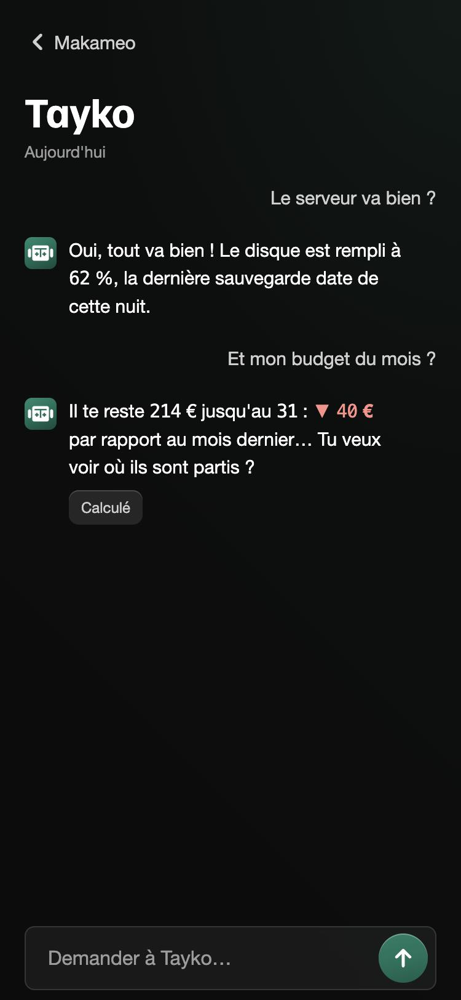
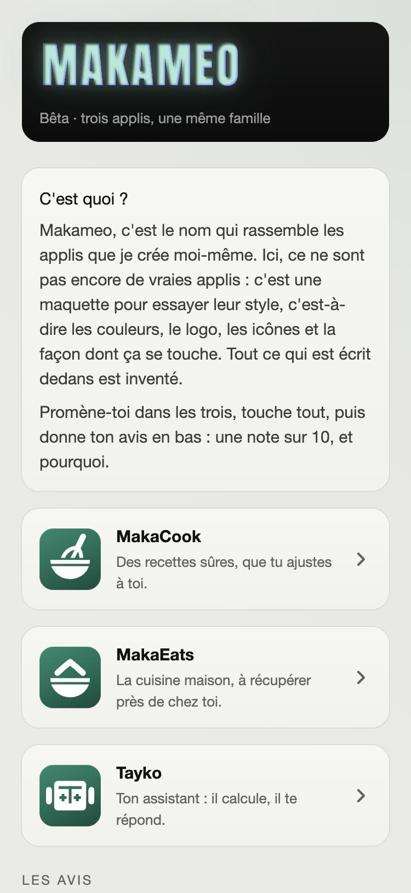
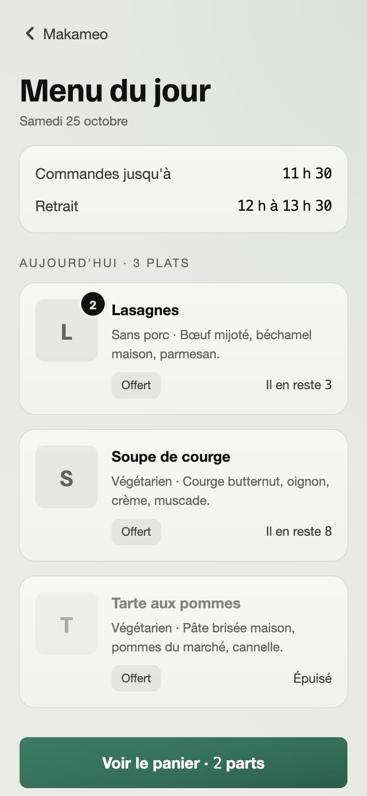
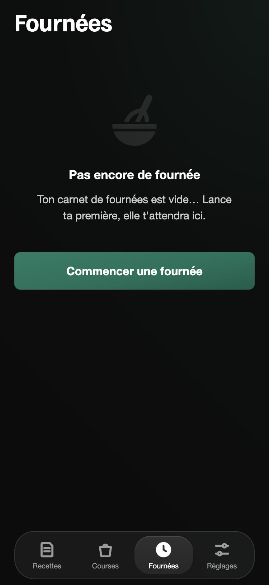

# Makameo — l'identité visuelle, version 1.0.1

Makameo, c'est le nom qui rassemble les applis que je crée moi-même : **MakaCook** (des recettes sûres, que tu ajustes à toi), **MakaEats** (la cuisine maison, à récupérer près de chez toi), **Tayko** (un assistant qui calcule et qui répond), et les suivantes.

Ce dépôt montre leur identité visuelle commune : **ce qui a été décidé, et pourquoi**. Pas seulement le résultat, aussi le chemin.

Version **1.0.1** : la 1.0.0 est sortie le 27/10/2026, validée point par point ; la 1.0.1 y ajoute le texte agrandi (un correctif). Elle ne bouge pas pendant six mois ; seul un vrai défaut (illisible, contraste, droit d'une police) se répare avant.

---

## La méthode

- **Une page blanche.** Je ne suis parti d'aucune appli existante : on a d'abord dessiné « l'écran de tout », puis chaque point.
- **Une décision à la fois**, toujours avec un avant / après à voir, et trois façons de faire quand il y avait un vrai choix (A, B, C).
- **Tout se juge sur une image d'ensemble** (un écran de MakaCook et un de MakaEats côte à côte), jamais un détail seul.
- **Ce qui vient en route attend** : une envie nouvelle est notée pour la version suivante, au lieu de tout faire bouger.
- **Essayé en vrai** : une bêta, une seule petite appli de présentation, testée sur iPhone, en sombre et en clair.

---

## La marque

**1. Le logo.** « MAKAMEO » en majuscules, police Anton. Les lettres sont vert clair et creusées, avec une ombre intérieure noire et un reflet néon bleu-violet. Il s'allume comme une lumière qui grésille.
*Pourquoi :* j'aime le futur glissé dans une époque passée, sans que ça sonne faux. Ici, une police d'affiche classique, et un seul détail du futur : le néon qui bugue. Le bleu-violet appartient à la marque, jamais aux écrans des applis.

**2. Le M seul.** Quand la place manque (une icône de Makameo, une étiquette, un poinçon), c'est le M, dans le même style.

**3. Les icônes des applis.** Un fond vert en léger dégradé, et un symbole blanc dessiné pour l'appli : un objet de la vie, jamais un symbole tout fait. C'est une forme pleine, avec les détails creusés dedans et des traits aux bouts arrondis. Toutes ont le même poids.

- **MakaEats** : le bol, sous un toit.
- **MakaCook** : le même bol, le fouet enfoncé dedans. Les deux partagent le bol : c'est la famille de la cuisine.
- **Tayko** : la tête d'un petit robot. Le T pour Tayko, les « + » pour le calcul, et un robot parce que ça parle à tout le monde.

Une icône nouvelle part d'un gabarit et se juge à côté des autres, avant d'entrer dans la famille.

---

## Le langage commun des applis

| | Ce qui est décidé | Pourquoi |
|---|---|---|
| **La couleur** | Un vert : foncé (#14715A) pour ce qu'on touche, clair (#B0E8DA) pour ce qu'on lit. Jamais en aplat. | Une seule couleur, rare, qui guide l'œil. |
| **Le fond** | Très sombre (#0c0c0c), des cartes un cran au-dessus, et un fondu vert très léger en haut. | Sobre, du noir, mais pas mort. |
| **Les lettres** | Familjen Grotesk pour les titres, la police du téléphone pour le texte, des chiffres alignés. | Des titres qui ont du caractère ; un texte qui se lit sans effort. |
| **Les tailles** | Titre 34, texte 15, petit 13, mini 12. | Une hiérarchie nette. |
| **L'espace et les coins** | Marges 20, blocs et cartes 16 ; coins de 16 pour les cartes, de 8 pour ce qu'on presse. | On voit tout de suite ce qui se touche. |
| **La lumière** | Un relief léger. Un trait de lumière d'un point en haut des petits détails, sans halo. | On la sent plus qu'on ne la voit. |
| **Les nouvelles** | Un signe et un mot : vert clair pour une bonne nouvelle, rouge doux pour une mauvaise. Jamais la couleur seule. | Lisible même sans voir les couleurs. |
| **Le point d'état** | « Allumé » : un point vert clair qui grésille doucement. « Éteint » : un anneau vide, au trait plein. | Un rond en pointillés se lit « ça charge » : il ne veut jamais dire « éteint ». |
| **Ce qui charge** | La ligne de la marque, qui glisse, comme sous le logo. Jamais une roue. | La même ligne partout, du lancement au moindre envoi. |
| **Le ton** | « L'appli te parle, mais n'est pas un robot. » | Clair d'abord, chaleureux sans être mignon. |
| **Ce qu'il n'y a pas** | Pas de décor, pas de bulles de dialogue, pas de personnages (sauf Tayko, qui en est un). | Le contenu d'abord. |

**Le mode clair** suit le réglage du téléphone, sans bouton dans l'appli. Le sombre est dessiné d'abord ; le clair en découle, adouci, sans blanc pur.

**Les écrans « entre deux ».** Au lancement, le logo s'allume avec sa barre. Un écran vide montre le symbole de l'appli, effacé, avec une phrase et le bouton qui fait sortir du vide. Pour confirmer, une feuille monte du bas, près du pouce.

**Pour tout le monde.** Le texte a un contraste d'au moins 4,5 contre 1, ce qu'on touche fait au moins 44 × 44 points, et le texte suit la taille choisie dans le téléphone, jusqu'à au moins 200 %, sans être coupé. Comme le recommande Apple.

---

## Ce qui viendra plus tard

Un vrai symbole de la marque, un son pour le logo, une palette d'éléments pour les affiches, la tablette… Tout ça est noté pour les prochaines versions, pas mélangé à celle-ci.

---

## Droits

© 2026 Makameo. Tous droits réservés. Ce dépôt n'a pas de licence : on peut le regarder et s'en inspirer, mais pas copier ni réutiliser ce qu'il contient.

Les polices Anton et Familjen Grotesk sont libres (SIL Open Font License) et appartiennent à leurs auteurs.

Les textes des maquettes sont inventés. Ce travail a été fait en dialogue avec Claude Code (Anthropic).
